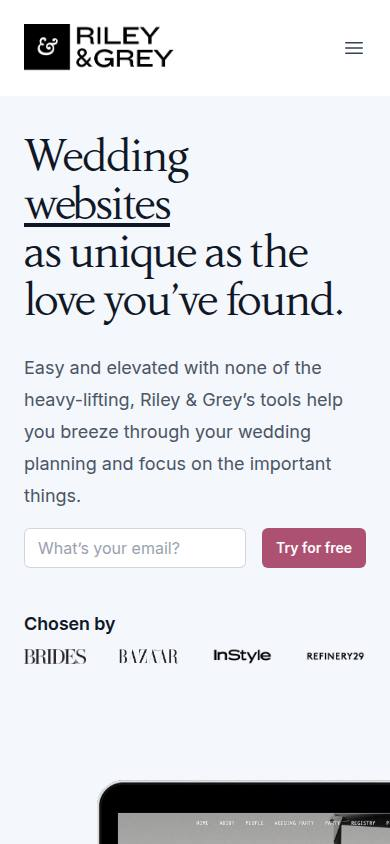
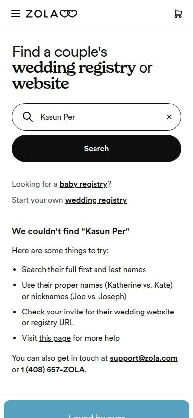
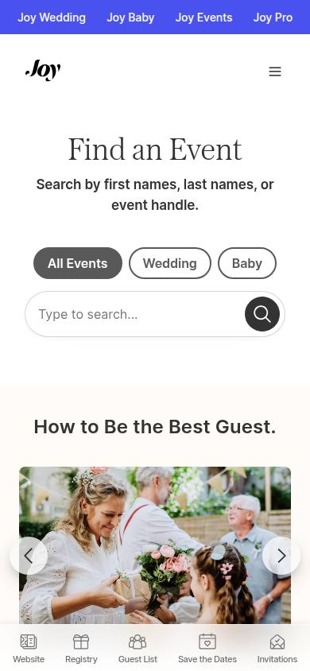
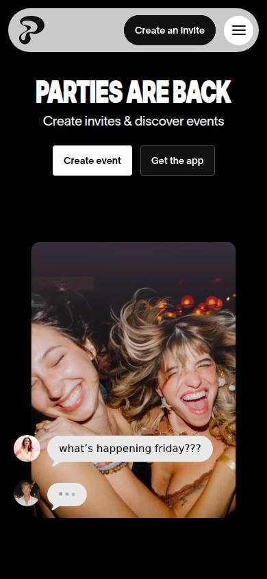
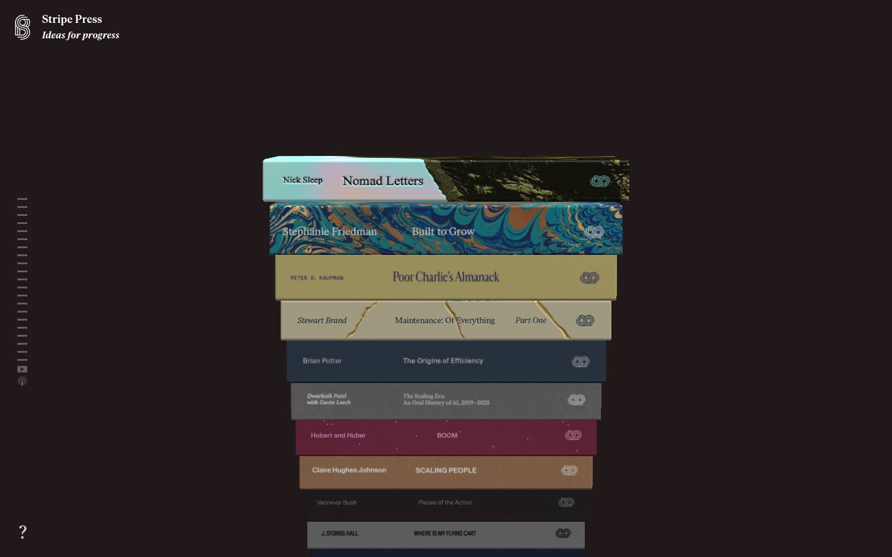
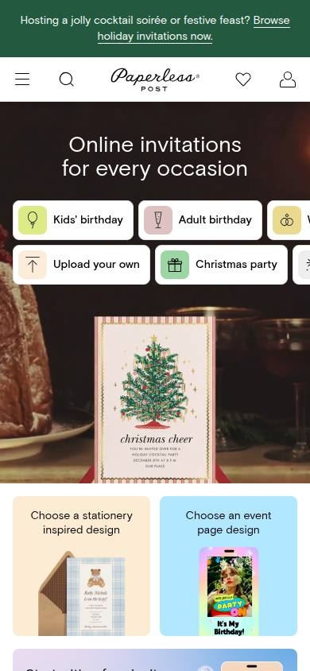

# Inspiration

Captured 15 Nov 2026 with Playwright at **390 × 844** (a typical phone held by a guest who just scanned a QR code) and **1440 × 900** (desktop). Above-the-fold only — that is all a guest at a venue door will ever see.

The goal was not to find something to copy but to answer six questions for a *single-purpose, name-in → table-out* page: how do excellent sites handle **typography, spacing, color, motion, input design and the result reveal**?

| # | Site | Why it's here | Files |
|---|------|---------------|-------|
| 1 | [Riley & Grey](https://www.rileygrey.com/) | Premium wedding-site builder; the best editorial type on a wedding product | `riley-grey-*.jpg` |
| 2 | [Zola — Find a couple](https://www.zola.com/search/wedding-registry) | A real guest-facing **name search** with a designed not-found state | `zola-*.jpg`, `zola-find-couple-*.jpg` |
| 3 | [Joy — Find an event](https://withjoy.com/find) | Name search + an **event filter** (closest analogue to our wedding/homecoming split) | `joy-*.jpg`, `joy-find-event-*.jpg` |
| 4 | [Partiful](https://partiful.com/) | Mobile-first event invitations; personality through motion and big touch targets | `partiful-*.jpg` |
| 5 | [Stripe Press](https://press.stripe.com/) | Award-winning typography + 3D motion; a lesson in both delight *and* its cost | `stripe-press-*.jpg` |
| 6 | [Linear](https://linear.app/) | The reference for restrained dark UI and motion craft | `linear-*.jpg` |
| 7 | [Paperless Post](https://www.paperlesspost.com/) | Invitations company — puts the **physical card** at the centre of the screen | `paperless-post-*.jpg` |

Minted and Aesop were also attempted but blocked automated browsers (Cloudflare 403), so they're omitted rather than described from memory.

---

## 1. Riley & Grey — editorial type on a wedding product

- **Typography.** A high-contrast transitional serif at display size (~44 px on mobile) with **tight leading (~1.05)**, paired with a quiet humanist sans for body at a comfortable 17–18 px / 1.7. The pairing does all the "luxury" work — there is almost no decoration.
- **Spacing.** Generous, consistent left gutter (24 px mobile, ~112 px desktop). Everything hangs off one vertical line, which is why it feels calm.
- **Color.** Near-monochrome (ink on a faint cool off-white) with a single dusty-rose accent reserved for the one primary action.
- **Input design.** Email input and button sit side by side at equal height — a clear "this is the one thing to do" unit.
- **Borrow:** one alignment axis; display serif with tight leading; *one* accent colour used only for the thing you should press.
- **Avoid:** the 44 px input height — too small for a thumb in a crowded venue. We'll go to 56 px+.

## 2. Zola — the guest-facing name search

- **Input design.** Big pill-shaped field (~56 px) with a search icon, clear (×) button, and a full-width black button below — excellent thumb ergonomics.
- **Not-found state.** Genuinely good copy: *"We couldn't find 'Kasun Per'"* followed by concrete fixes ("use their full name", "try nicknames") and a human fallback (support contact). This is the model for our "please ask an usher" state.
- **But — the anti-pattern.** It declared *"We couldn't find"* while I was **still typing** ("Kasun Per" is half a surname). Showing an error before the person has finished is the digital equivalent of interrupting. **Lesson: only show not-found after the guest pauses or submits, and never for queries shorter than ~3 letters.**
- **Borrow:** the 56 px field + clear button; specific, helpful failure copy with a human fallback.
- **Avoid:** premature errors; a separate "Search" button when results can appear live.

## 3. Joy — event filter + search

- **Typography.** A softer serif headline ("Find an Event") over a plain instructional subhead that tells you *exactly* what you can type ("first names, last names, or event handle"). Telling people what input is accepted reduces failed searches.
- **Event filter.** Pill chips — *All Events · Wedding · Baby* — sit **above** the input. This is the pattern for our two events, but notice it forces a decision *before* searching. We can do better: the QR code already tells us which event the guest is at, so the chooser should be pre-selected and visually secondary.
- **Input design.** Nothing happens as you type (second screenshot is identical to the first) — you must hit the round button. Live suggestions would remove a step.
- **Borrow:** instructional helper text that names acceptable inputs; segmented control for the event.
- **Avoid:** making the guest choose the event up front; requiring a submit tap.

## 4. Partiful — mobile-first personality

- **Typography.** A condensed ultra-bold display face makes the brand instantly recognisable. Proof that *one* characterful face, used with restraint, is enough identity.
- **Touch targets.** Every control is a 48 px+ pill with generous padding. Two-button rows are equal width — no tiny secondary links.
- **Motion.** Chat bubbles and a typing indicator animate in — motion that **tells a story** (people are talking about this party) rather than decorating.
- **Color.** True black with photography carrying all the colour.
- **Borrow:** motion that means something; large equal-weight targets.
- **Avoid:** the party energy — wrong register for a church wedding.

## 5. Stripe Press — delight, and its price

- **Typography.** Each book spine is set in its own typeface — type *as* the content. The site chrome itself is a tiny, quiet serif wordmark.
- **Motion.** A WebGL stack of books you can scroll through; tactile and memorable.
- **The lesson I didn't expect:** my first mobile capture after 4 s was a **completely blank brown screen** (`stripe-press-mobile.jpg` was retaken after 9 s, and even then the 3D crop is awkward on a narrow phone). On venue Wi-Fi, that blank screen is what a guest would see. **Lesson: the "moment" must be built from lightweight CSS transforms on content that's already rendered — never a heavy asset the page waits for.**
- **Borrow:** the idea of one tactile, object-like moment; quiet chrome around it.
- **Avoid:** anything that blocks first paint.

## 6. Linear — restraint and dark craft

- **Typography.** A single neo-grotesk in two weights; hierarchy comes from size and *colour value* (white headline, ~60 % grey body), not from adding fonts.
- **Color.** Not pure black — a slightly lifted near-black with hairline borders at ~8 % white. Dark UIs look expensive when they have *layers* of near-black, cheap when everything is #000.
- **Motion.** Subtle, fast (150–250 ms), eased with a strong ease-out; nothing bounces.
- **Borrow:** layered dark surfaces (for the evening homecoming page); short, confident ease-out timing.
- **Avoid:** its mid-grey secondary text — at that size it flirts with failing WCAG AA. We'll verify every pair.

## 7. Paperless Post — the card is the hero

- **Concept.** The physical invitation card sits in the middle of the screen, photographed with a soft shadow. The product *is* the artefact.
- **Spacing/colour.** Busy overall (promo bar, category chips, colourful tiles) — a marketplace, not a moment.
- **Borrow:** treating a paper artefact as the on-screen object. Our guest is holding (or has just looked at) a physical invitation — the screen should feel like its continuation.
- **Avoid:** marketplace density.

---

## What we're taking — the synthesis

1. **Continuity with the invitation is the whole brand.** The guest scanned a QR code on (or next to) a printed card with olive petals or burgundy petals. The page should look like that card came to life — same palette, same letterspaced caps, same petal motif. *(Paperless Post)*
2. **One alignment axis, one accent, one face with character.** Calm comes from discipline, not decoration. *(Riley & Grey, Partiful, Linear)*
3. **A thumb-sized, live, forgiving search field.** 56 px+, clear button, suggestions as you type, helper text naming what you can type. *(Zola, Joy)*
4. **Errors only when the guest is done.** Debounce, minimum length, then a kind not-found with a human fallback. *(Zola — both what it does right and wrong)*
5. **Context replaces choices.** The QR code already knows which event; pre-select it and keep the switch quiet. *(Joy — improved upon)*
6. **The reveal is an object, not a firework.** A wedding already has a physical artefact for "here is your table": the **escort card** (the little folded card with your name and table number at the entrance). The result should feel like receiving that card — built from CSS transforms on already-rendered text, so it costs nothing to load. *(Stripe Press — the good half)*
7. **Fast, eased, short motion; nothing that bounces; nothing that blocks paint.** *(Linear, Stripe Press — the cautionary half)*
